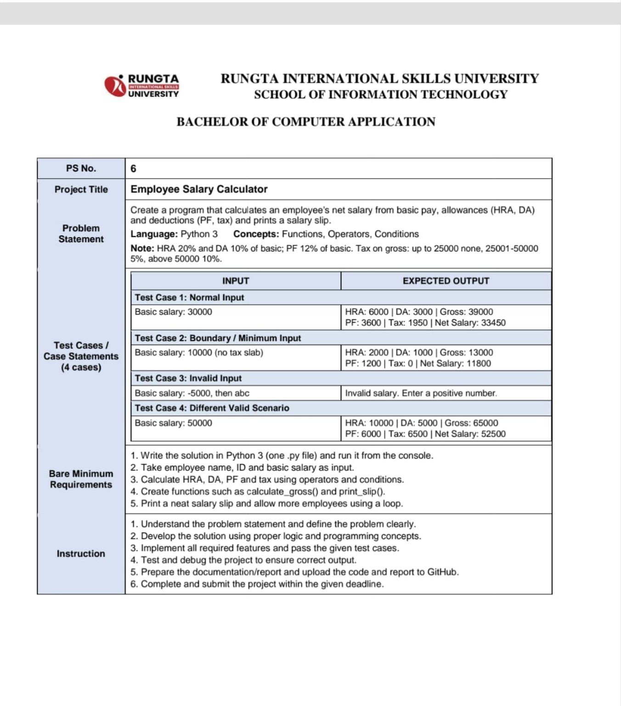

# Employee Salary Calculator

**Project Number:** PS No. 6\
**Student Name:** Soni Sahu\
**Course:** Bachelor of Computer Application (BCA)\
**Programming Language:** Python 3

## Project Description

The Employee Salary Calculator is a Python program that calculates an
employee's gross salary, deductions, and net salary using the employee's
basic salary.

The program calculates: - House Rent Allowance (HRA) - Dearness
Allowance (DA) - Provident Fund (PF) - Income tax - Net salary

## Calculation Rules

  -----------------------------------------------------------------------
  Component                           Calculation
  ----------------------------------- -----------------------------------
  HRA                                 20% of basic salary

  DA                                  10% of basic salary

  Gross Salary                        Basic Salary + HRA + DA

  PF                                  12% of basic salary

  Tax                                 0% when gross salary is up to
                                      25,000; 5% when gross salary is
                                      25,001--50,000; 10% when gross
                                      salary is above 50,000

  Net Salary                          Gross Salary − PF − Tax
  -----------------------------------------------------------------------

## Concepts Used

-   Python functions
-   Arithmetic operators
-   Conditional statements (`if`, `elif`, `else`)
-   `for` loop
-   `try` and `except` for invalid numeric input

## Files in This Repository

-   `one.py` --- Python source code for the salary calculator.
-   `README.md` --- Project description and instructions.
-   `Test_cases_passed.pdf` --- Test-case summary and console-output
    screenshot.
-   `PS_No_6_Screenshot.png` --- Project allocation details screenshot
    (add this file if required by your instructor).

## How to Run

1.  Install Python 3 on your computer.
2.  Open a terminal or command prompt in the project folder.
3.  Run:

``` bash
python one.py
```

If your system uses the `python3` command, run:

``` bash
python3 one.py
```

4.  Enter a basic salary when prompted.

## Test Cases

  ------------------------------------------------------------------------
  Test Case                             Basic Salary Result
  --------------------- ---------------------------- ---------------------
  1 --- Normal input                          30,000 HRA: 6,000; DA:
                                                     3,000; Gross: 39,000;
                                                     PF: 3,600; Tax:
                                                     1,950; Net Salary:
                                                     33,450

  2 --- Boundary /                            10,000 HRA: 2,000; DA:
  minimum input                                      1,000; Gross: 13,000;
                                                     PF: 1,200; Tax: 0;
                                                     Net Salary: 11,800

  3 --- Invalid input                         -5,000 Invalid salary
                                                     message is displayed

  4 --- Different valid                       50,000 HRA: 10,000; DA:
  scenario                                           5,000; Gross: 65,000;
                                                     PF: 6,000; Tax:
                                                     6,500; Net Salary:
                                                     52,500
  ------------------------------------------------------------------------

**Test result:** The four test cases shown in the attached console
screenshot produced the expected results. 

## Project Screenshot



## Author

**Soni Sahu**\
Bachelor of Computer Application (BCA)\
**Project:** Employee Salary Calculator --- PS No. 6
